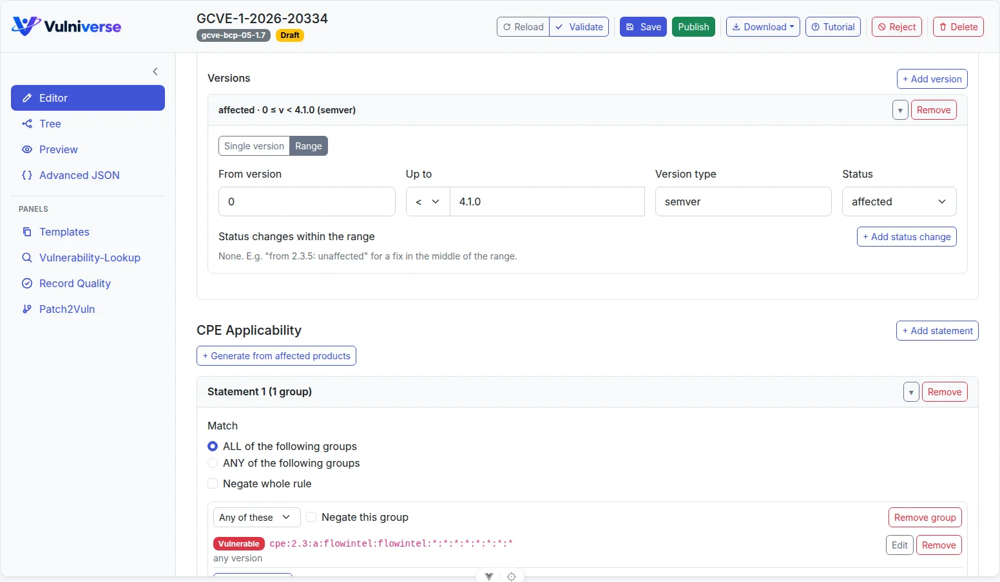
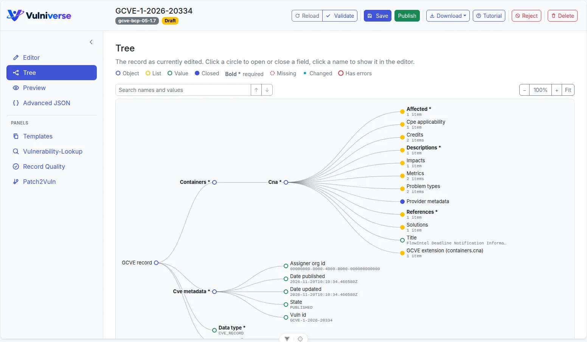
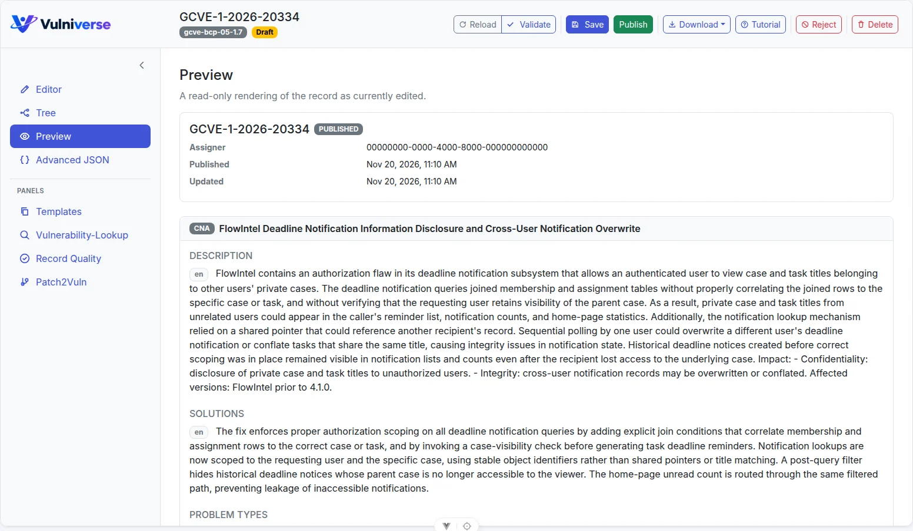
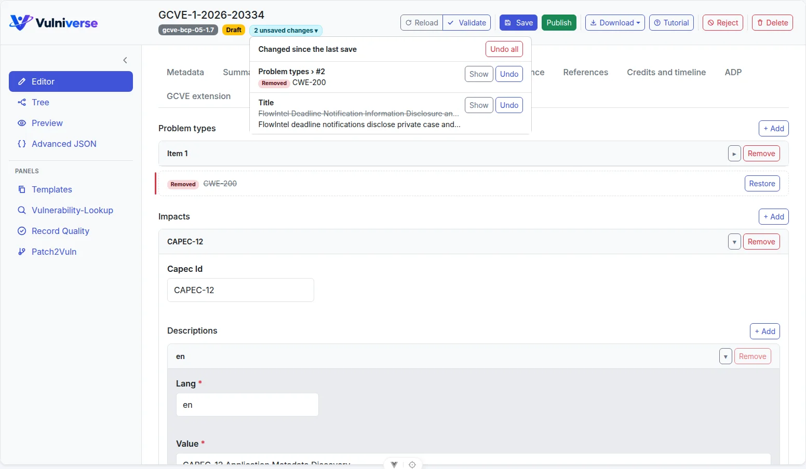
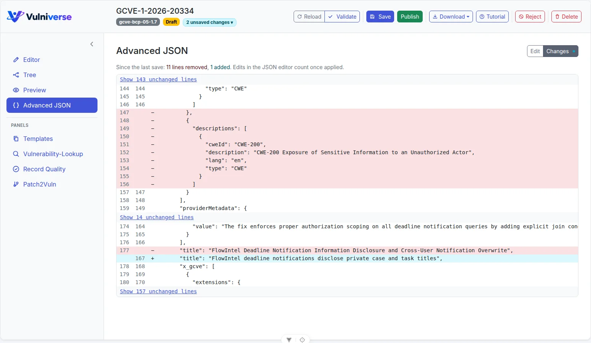
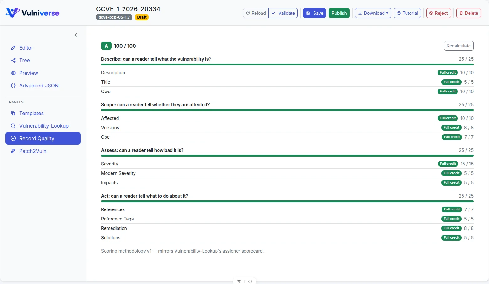

  <picture>
    <source media="(prefers-color-scheme: dark)" srcset="docs/docs/images/logo-dark.png">
    
  </picture>

  
  
  
  

Vulniverse is a web editor for vulnerability records in **CVE Record Format
5.2.0**, **GCVE BCP-05 1.7** and **OSV 1.9.2**. Guided forms know the
schema, so you describe the vulnerability and Vulniverse gets the
structure right: version ranges, CVSS scores, CWE and CAPEC references,
credits and all the rest. It's the vulnerability editor of
[Vulnerability-Lookup](https://github.com/vulnerability-lookup/vulnerability-lookup).

  <a href="https://vulnerability-lookup.github.io/vulniverse/"><b>Try it in your browser</b></a> (no installation, no account) ·
  <a href="https://vulnerability-lookup.github.io/vulniverse/docs/quickstart/single-user/">Run it yourself</a> ·
  <a href="https://vulnerability-lookup.github.io/vulniverse/docs/quickstart/embed/">Embed it in your app</a>

  <picture>
    <source media="(prefers-color-scheme: dark)" srcset="docs/docs/images/editor-demo-dark.webp">
    
  </picture>

<i>From a patch to a published GCVE record: draft it with Patch2Vuln, check it, publish it to Vulnerability-Lookup.</i>

## One record, every view you need

<table>
  <tr>
    <td width="50%" valign="top">
      <h4>Forms that know the schema</h4>
      
Every field of the record, laid out the way you think about it. Version ranges read like a sentence, version types are suggested as you type, and a calculator builds the CVSS vector.

      <picture>
        <source media="(prefers-color-scheme: dark)" srcset="docs/docs/images/screenshots/editor-dark.webp">
        
      </picture>
    </td>
    <td width="50%" valign="top">
      <h4>The whole record at a glance</h4>
      
A tree of everything in the record, with what's required, missing or changed. Search names and values, then jump straight to the field in the form.

      <picture>
        <source media="(prefers-color-scheme: dark)" srcset="docs/docs/images/screenshots/tree-dark.webp">
        
      </picture>
    </td>
  </tr>
  <tr>
    <td width="50%" valign="top">
      <h4>See it as your readers will</h4>
      
A rendered preview of the record (description, affected versions, severity, references) before anyone else does.

      <picture>
        <source media="(prefers-color-scheme: dark)" srcset="docs/docs/images/screenshots/preview-dark.webp">
        
      </picture>
    </td>
    <td width="50%" valign="top">
      <h4>Every change in sight</h4>
      
Edits are marked in the form and listed in one place with the old and new value. Undo a single change, or restore an entry you removed.

      <picture>
        <source media="(prefers-color-scheme: dark)" srcset="docs/docs/images/screenshots/changes-dark.webp">
        
      </picture>
    </td>
  </tr>
  <tr>
    <td width="50%" valign="top">
      <h4>The JSON, when you want it</h4>
      
Edit the raw record directly, or compare it line by line with the last save before you commit to it.

      <picture>
        <source media="(prefers-color-scheme: dark)" srcset="docs/docs/images/screenshots/json-changes-dark.webp">
        
      </picture>
    </td>
    <td width="50%" valign="top">
      <h4>Know it's complete</h4>
      
A quality score shows what a reader would miss (scope, severity, what to do about it) before a reviewer has to point it out.

      <picture>
        <source media="(prefers-color-scheme: dark)" srcset="docs/docs/images/screenshots/quality-dark.webp">
        
      </picture>
    </td>
  </tr>
</table>

## Why Vulniverse

- **Start from the fix.** Point Patch2Vuln at a commit and it drafts the
  record for you: description, affected files, weakness and severity, for
  you to review and apply field by field.
- **Publish where it counts.** Reserve GCVE IDs and publish to
  Vulnerability-Lookup, or to the CVE Program as a CNA, from the same
  screen you write in.
- **Never start from a blank page.** Templates fill in what your records
  have in common: your vendor, your references, your boilerplate.
- **Made for teams.** Organisations, roles, invitations and two-factor
  authentication.
- **Fits into your tools.** The editor is also a single Web Component,
  `<vulniverse-editor>`, which you can drop into your own application with
  your own storage behind it.

## Get started

| | |
|---|---|
| **Try it now** | The [live demo](https://vulnerability-lookup.github.io/vulniverse/) runs entirely in your browser. |
| **Run it yourself** | Follow the quick start [for yourself](https://vulnerability-lookup.github.io/vulniverse/docs/quickstart/single-user/) or [for your team](https://vulnerability-lookup.github.io/vulniverse/docs/quickstart/team/), or [build it from source](https://vulnerability-lookup.github.io/vulniverse/docs/development/from-source/). |
| **Embed it** | Add [`<vulniverse-editor>`](https://vulnerability-lookup.github.io/vulniverse/docs/quickstart/embed/) to your application, as [Vulnerability-Lookup does](https://vulnerability-lookup.github.io/vulniverse/docs/embedding/vl/). |

Configuration, production setup and the architecture are described in the
[documentation](https://vulnerability-lookup.github.io/vulniverse/docs/).

## License

Vulniverse is released under the [BSD 2-Clause License](LICENSE).
